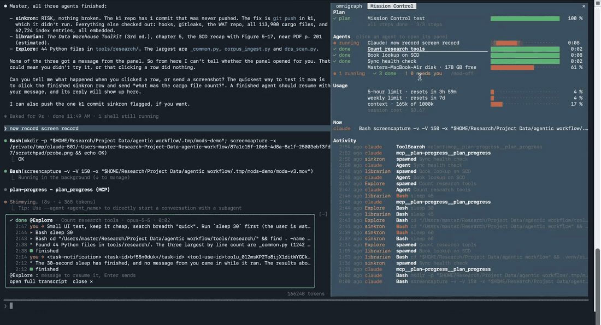

# Claude Code side mods

Three Claude Code mods that keep the chat on the left and show, on the right, what Claude and each of its agents is doing while it works.

Author: Hilmi, https://master-hilmi.vercel.app/



The clip runs 32 seconds. [Full-size MP4](media/demo.mp4).

## What you get

`/mod-on` opens the right side. `/mod-off` closes it again.

**Mission Control** is a live pane with five sections:

- **Plan**: one row per plan bar, with a fill meter, the percentage, the current step and a step count.
- **Agents**: Claude and every agent it spawns, each with its state (running, done, needs you, failed), a sliding bar and a timer. Click an agent's row and a panel opens at the bottom, above the prompt. It shows what that agent is doing (its tool calls, what it says, how it ended) and has an `@agent` field. Type a message there and press Enter to send it to the agent, as `@agent` does in Claude Code. A finished agent resumes with your message.
- **Usage**: the figures `/usage` shows, kept live: the 5-hour and weekly limits with their reset times, context fill and session cost.
- **Now** and **Activity**: what each agent is running at this moment, and a feed of recent tool calls.

**side-plan-progress** draws the plan bars that Mission Control reads. Claude fills them through its `plan_progress` tool, and a "Tasks" bar fills by itself from Claude's own task list.

**side-omnigraph-viz** draws the session as a graph: Claude in the centre, each agent linked to whoever spawned it, and every tool call and file it touched. This activity graph lives in memory only and writes no files. If you run the `omnigraph` CLI against a graph store, the first `omnigraph` command hands the pane to that store's graph and the mod then behaves as [the original](https://github.com/pronskiy/omnigraph-claude-mod) does, with its ledger in `.omnigraph-viz/` in your project and its op count on the status line.

## Install

At the prompt of a Claude Code terminal session, install the three mods:

```
/plugin install mission-control --marketplace masterA88/claude-side-mods
/plugin install side-plan-progress --marketplace masterA88/claude-side-mods
/plugin install side-omnigraph-viz --marketplace masterA88/claude-side-mods
```

Answer `y` to add the marketplace, then pick a scope (user scope loads them in every session). Then type `/mod-on`.

From a shell:

```
claude plugin install mission-control --marketplace masterA88/claude-side-mods
claude plugin install side-plan-progress --marketplace masterA88/claude-side-mods
claude plugin install side-omnigraph-viz --marketplace masterA88/claude-side-mods
```

In the desktop app, where `/plugin` does not run: click + next to the prompt box, then Plugins, Add marketplace with `masterA88/claude-side-mods`, then Add plugin for each of the three.

The right pane opens unasked only when the terminal is wide enough (from about 144 columns), so give the window room or open it with `/mc`.

## Commands

| Command | Mod | What it does |
|---|---|---|
| `/mod-on`, `/mod-off` | mission-control | Turn the right side on or off for all three mods |
| `/mc` | mission-control | Show or hide the Mission Control pane |
| `/progress`, `/progress-on`, `/progress-off` | side-plan-progress | Show or hide the bars, or the separate Plan pane |
| `/progress-clear`, `/progress-agents` | side-plan-progress | Clear all bars; fold or show the agent strips |
| `/plan-progress-autoclose`, `/plan-progress-settings` | side-plan-progress | Let finished bars leave on their own; open the settings |
| `/og-on`, `/og-off` | side-omnigraph-viz | Open or close the graph pane |

The three mods share one switch, `~/.claude/side-mods/mods-on.json`, which `/mod-on` and `/mod-off` write. Each mod watches it, because one mod cannot run another mod's command.

## Credits

Two of the three mods are forks of other people's work, and Mission Control borrows ideas from both. Each fork keeps its original MIT license and copyright notice in its folder.

- **side-plan-progress** is a fork of the plan-progress mod in [zycck/claude-mods](https://github.com/zycck/claude-mods) by Kirill Serditov (MIT, `plugins/plan-progress/LICENSE`). The bars, the pixel fill, the agent strips, the sounds and the `plan_progress` tool are his. This fork moves the bars into a pane on the right, puts them under the shared `/mod-on` switch, and fills a bar from Claude's own task list.
- **side-omnigraph-viz** is a fork of [pronskiy/omnigraph-claude-mod](https://github.com/pronskiy/omnigraph-claude-mod) by Roman Pronskiy (MIT, `plugins/omnigraph-viz/LICENSE`). The graph drawing, the layout and the omnigraph command handling are his. This fork adds `/og-on` and `/og-off`, the shared switch, and a graph of the session's own activity for use without an omnigraph store.
- **mission-control** is new code by Hilmi (MIT, `plugins/mission-control/LICENSE`). Its Plan section reads side-plan-progress's bars and does not copy its code.
- The always-on companion in the original setup is Anthropic's built-in "You should know" plugin (`/plugin enable cc-plugin-you-should-know@builtin`). It is not part of this repository.
- The mods are built on the Claude Code mod API (`ui.render`, panes, the band above the prompt, `$.session.send`) by Anthropic.

## Requirements and known limits

- Built and tested on Claude Code 2.1.302, the version that ships the mod API these use. Older versions may not load them.
- The panes are made for the terminal. Mission Control's agent panel is also tested on the desktop app's surface. omnigraph's graph is drawn only in the terminal, as upstream.
- The disk row uses `df` and `hostname`, so it appears on macOS and Linux and is left out on Windows.
- Mission Control's Plan section reads side-plan-progress's bars, so it stays empty if side-plan-progress is not installed. Everything else works on its own.
- Agents usually finish in seconds, so there is little time to click one while it runs. You can still open the panel on a finished agent and message it, which resumes it.
- The activity graph starts over if the mods are reloaded mid-session.

Tests: Mission Control 11 of 11 and side-omnigraph-viz 271 of 271 (`claude plugin test plugins/<mod>`). The side-plan-progress fork carries no tests of its own.

## License

MIT. `LICENSE` at the top covers Mission Control and the changes made in the forks. Each fork's own `LICENSE` covers its original code.
